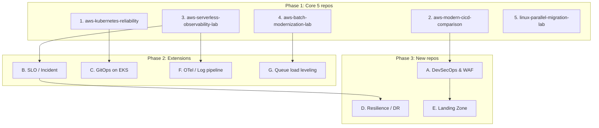

# Additional Portfolio Themes (CV-driven)

[portfolio-roadmap.md](./portfolio-roadmap.md) の5テーマで手薄になる **CV上の強み** を拾い、公開されている定番ハンズオン／OSSと組み合わせて「実務経験 × 公開教材 × 自分の検証」に仕立てた追加テーマです。

方針は5テーマと同じで、各テーマは **2〜3時間・無料枠中心・障害注入・英語での説明** を基本とします。新しいリポジトリは増やしすぎず、**既存5本への拡張（Extension）** と **新規リポジトリ（New repo）** に分けています。

---

## 1. CV棚卸し：5テーマでカバーしきれない強み

| CV上の経験・資格 | 5テーマでのカバー | ギャップ |
|---|---|---|
| WAF チューニング、Inspector / Vuls 週次トリアージ、PCI DSS 対応、CSP レポート基盤 | ほぼ無し | **Security / DevSecOps**（最大のギャップ） |
| AWS Security Specialty、AZ-500、SC-200、PenTest+、情報処理安全確保支援士 | 無し | 資格を「手を動かした証拠」に変換できていない |
| Terraform + GitHub CI/CD の提案（Avanade）、11部門横断のガバナンス | ② で一部 | **マルチアカウント / Landing Zone / Policy as Code** |
| 30サブシステムの RTO/RPO ティア定義 | 無し | **DR / Resilience の実測** |
| 週3〜5件の障害対応、平均30分未満で復旧 | ③ で一部 | **SLO / error budget / postmortem** の言語化 |
| SOC PoC（Elastic Agent / Logstash / Elasticsearch / CloudWatch Logs / セキュリティ API 連携） | 無し | **ログパイプライン / OpenTelemetry** |
| Nginx でのスロットリング・負荷制御、SQS / EventBridge の retry | ③④ で一部 | **Queue-based load leveling / backpressure** |
| Entra ID SSO、AZ-104 / AZ-500 | 無し | **Entra ID ↔ AWS IAM Identity Center** 連携 |

---

## 2. 推奨する追加テーマ（優先順）

| # | テーマ | 形態 | 主な公開教材 | 狙い |
|---|---|---|---|---|
| A | DevSecOps pipeline & WAF | **New repo** `aws-devsecops-lab` | OWASP Juice Shop, Trivy, Checkov, Prowler | セキュリティ資格 × 実務を DevOps 文脈で証明 |
| B | SLO / Error Budget / Incident | Extension → ③ と ① | Google SRE Workbook, Sloth | 障害対応実績を SRE の言語で説明 |
| C | GitOps & Platform on EKS | Extension → ① (Phase 2) | EKS Workshop, Argo CD, Karpenter, Kyverno | カナダ求人で頻出の K8s 運用スキル |
| D | DR / Resilience & Chaos | **New repo** `aws-resilience-dr-lab` | AWS FIS, AWS Backup, Well-Architected Reliability Pillar | RTO/RPO 定義を「実測」に変える |
| E | Multi-account Landing Zone & Policy as Code | **New repo** `aws-landing-zone-governance` | AWS Organizations / SCP, IAM Identity Center, Conftest (OPA) | 提案レベルの Terraform + ガバナンスを実装レベルへ |
| F | Log pipeline & OpenTelemetry | Extension → ③ | OpenTelemetry Demo, ADOT, Grafana LGTM | SOC PoC 経験をモダンな可観測性基盤に接続 |
| G | Queue-based load leveling | Extension → ④ | Amazon SQS DLQ docs, k6 | スロットリング・retry 経験を設計パターンとして説明 |

> **優先順の理由:** A はカナダの DevOps/SRE 求人で「Security mindset / shift-left」が頻出かつ CV の最大の強みを活かせる。B・C は既存リポジトリの延長で低コストに SRE らしさを足せる。D・E は CV の上流（要件定義・ガバナンス）経験を示せるが、構築コストがやや高いので後半に置く。

---

## 3. 各テーマの設計

### A. aws-devsecops-lab（New repo）

**CVとの接続:** WAF チューニング、Inspector / Vuls の週次トリアージ、PCI DSS、CSP レポート基盤、セキュリティ資格群。

**組み合わせる公開教材**

- [OWASP Juice Shop](https://owasp.org/www-project-juice-shop/) — 意図的に脆弱な Web アプリ（攻撃対象）
- [Trivy](https://github.com/aquasecurity/trivy) — コンテナイメージ / IaC / SBOM スキャン
- [Checkov](https://github.com/bridgecrewio/checkov) — Terraform の静的解析
- [Prowler](https://github.com/prowler-cloud/prowler) — AWS アカウントの CSPM チェック
- [AWS WAF Developer Guide](https://docs.aws.amazon.com/waf/latest/developerguide/waf-chapter.html) — マネージドルール、rate-based rule

**2〜3時間スコープ**

1. GitHub Actions に Trivy（image + `config` スキャン）と Checkov を追加し、HIGH/CRITICAL でビルドを fail
2. Juice Shop を ECS Fargate（または ① の EKS）+ ALB で公開し、AWS WAF（Core rule set + SQLi + rate-based rule）を関連付け
3. **Count モード → Block モード** の順に切り替え、誤検知（false positive）を確認してから適用
4. Prowler を1回実行し、上位の指摘を `docs/security-findings.md` にトリアージ（Inspector / Vuls 週次運用の再現）

**障害・攻撃の注入**

- 脆弱なベースイメージ / 公開 S3 バケットを含む PR → パイプラインが止まることを確認
- Bash / k6 でリクエストを集中 → rate-based rule が発動
- SQLi / XSS ペイロード → WAF ログ（CloudWatch Logs）で該当ルールを特定

**成果物:** `docs/waf-tuning.md`（Count → Block の判断基準）、`docs/vuln-triage-policy.md`（CVSS × 到達可能性 × 露出で優先度付け）、`docs/pci-dss-mapping.md`（実装した統制と PCI DSS 要件の対応、簡易版）

**コスト注意:** WAF は Web ACL・ルール・リクエスト課金（無料枠なし）。検証当日のみ作成して destroy。

> **English summary:** I built a shift-left security pipeline with Trivy and Checkov, protected an intentionally vulnerable app with AWS WAF, and documented how I tuned rules from count mode to block mode to avoid false positives — mirroring the WAF tuning and weekly vulnerability triage I did in production.

---

### B. SLO / Error Budget / Incident Management（Extension → ③, ①）

**CVとの接続:** 週3〜5件の障害対応、平均30分未満での復旧。これを「MTTR が短い」だけでなく **SLO と error budget で語れる** ようにする。

**組み合わせる公開教材**

- [Google SRE Workbook – Implementing SLOs](https://sre.google/workbook/implementing-slos/)
- [Google SRE Workbook – Alerting on SLOs](https://sre.google/workbook/alerting-on-slos/)（multi-window, multi-burn-rate）
- [Sloth](https://github.com/slok/sloth) — Prometheus 用の SLO / burn-rate ルール生成（① の EKS 側）
- [Google SRE Book – Postmortem Culture](https://sre.google/sre-book/postmortem-culture/)

**2〜3時間スコープ**

1. ③ の API に SLI を定義（availability = 非5xx比率、latency = p95 < 500ms）、SLO 99.5% / 30日
2. CloudWatch metric math で error rate を計算し、**fast burn（1h / 14.4x）** と **slow burn（6h / 6x）** の2本のアラームを作成
3. `/error` 注入で budget を消費させ、どちらのアラームがいつ発火するかを記録
4. SNS → メール（または Amazon Q Developer in chat applications 経由で Slack）に通知
5. 模擬インシデントの **blameless postmortem** を `docs/postmortems/` に作成（Timeline / Impact / Root cause / Action items）

**成果物:** `docs/slo.md`、`docs/alerting-policy.md`（なぜ CPU ではなく burn rate でページするか）、`docs/postmortems/YYYY-MM-DD-error-spike.md`、`docs/incident-response.md`（Severity 定義、役割、エスカレーション）

> **English summary:** I defined SLIs and SLOs for a serverless API, implemented multi-window burn-rate alerts in CloudWatch, and wrote a blameless postmortem for an injected incident — turning my experience of handling 3–5 incidents a week into an SLO-driven practice.

---

### C. GitOps & Platform on EKS（Extension → ① Phase 2）

**CVとの接続:** Blue/Green・Ansible・CloudFormation での「宣言的な構成管理」の経験を Kubernetes の GitOps へ拡張。カナダの SRE / Platform 求人で Argo CD・Helm・Karpenter は頻出。

**組み合わせる公開教材**

- [EKS Workshop](https://www.eksworkshop.com/) — Autoscaling（Karpenter）、Observability、Security の各章を抜粋して利用
- [Argo CD Getting Started](https://argo-cd.readthedocs.io/en/stable/getting_started/)
- [Karpenter](https://karpenter.sh/)
- [kube-prometheus-stack](https://github.com/prometheus-community/helm-charts/tree/main/charts/kube-prometheus-stack)
- [Kyverno](https://kyverno.io/) — Policy as Code（requests/limits・probe 必須化）

**2〜3時間スコープ**

1. 本リポジトリの `k8s/` を Kustomize（`base` / `overlays/dev`）化
2. Argo CD をインストールし、Git の変更で自動 sync → 手動で `kubectl edit` した drift が戻ることを確認（self-heal）
3. Kyverno で「requests/limits と readinessProbe が無い Deployment を拒否」するポリシーを適用
4. HPA で Pod が増え Node 容量不足 → Pending → Karpenter（または Cluster Autoscaler）で Node 追加、までを記録
5. kube-prometheus-stack で HPA・Pod restart・Node 数を Grafana に表示

**成果物:** `docs/gitops.md`（push 型 CI/CD vs pull 型 GitOps）、`docs/policy-as-code.md`、`docs/node-autoscaling.md`（HPA と Node autoscaler の関係）

**コスト注意:** EKS コントロールプレーンと追加 Node が時間課金。②の EKS 検証と同じ日にまとめて実施し即 destroy。

> **English summary:** I extended my EKS lab with GitOps using Argo CD, enforced reliability guardrails with Kyverno, and showed how pod-level HPA and node-level Karpenter work together when capacity runs out.

---

### D. aws-resilience-dr-lab（New repo）

**CVとの接続:** 30サブシステムの RTO/RPO ティア定義（要件定義側の経験）。これを **実際に復旧して時間を測る** ことで、要件と実装の両方を語れるようにする。

**組み合わせる公開教材**

- [AWS Well-Architected – Reliability Pillar](https://docs.aws.amazon.com/wellarchitected/latest/reliability-pillar/welcome.html)
- [Disaster Recovery of Workloads on AWS（Whitepaper）](https://docs.aws.amazon.com/whitepapers/latest/disaster-recovery-workloads-on-aws/disaster-recovery-workloads-on-aws.html) — Backup & Restore / Pilot Light / Warm Standby / Multi-site
- [AWS Fault Injection Service (FIS)](https://docs.aws.amazon.com/fis/latest/userguide/what-is.html)
- [AWS Backup](https://docs.aws.amazon.com/aws-backup/latest/devguide/whatisbackup.html)
- [Route 53 DNS failover](https://docs.aws.amazon.com/Route53/latest/DeveloperGuide/dns-failover.html)

**2〜3時間スコープ**

1. 小さな Web + RDS（または DynamoDB）構成を Terraform で作成し、AWS Backup プランを設定
2. **Backup & Restore** を実行して RTO（復旧所要時間）と RPO（失われたデータ時間）を実測
3. 別リージョンへ S3 静的サイトを用意し、Route 53 health check で **フェイルオーバー** を確認
4. FIS で EC2 停止 / ECS タスク停止を注入し、ALB と Auto Scaling の自己回復を観測
5. 「Tier 1/2/3 × 戦略 × 実測値 × コスト」の表を作成

**成果物:** `docs/rto-rpo-tiers.md`（CV の考え方を匿名化したティア設計）、`docs/dr-test-results.md`（目標 vs 実測）、`docs/runbook-failover.md`

> **English summary:** I translated RTO/RPO requirements into tested recovery strategies, measured actual recovery times with AWS Backup and Route 53 failover, and validated self-healing with AWS Fault Injection Service.

---

### E. aws-landing-zone-governance（New repo）

**CVとの接続:** Avanade での Terraform + GitHub CI/CD の提案、11部門横断のガバナンス、Entra ID SSO。CV上「提案・方針策定寄り」だった部分を **小さく実装** して、誇張せずに補強する。

**組み合わせる公開教材**

- [AWS Organizations – SCP](https://docs.aws.amazon.com/organizations/latest/userguide/orgs_manage_policies_scps.html)
- [IAM Identity Center + Microsoft Entra ID](https://docs.aws.amazon.com/singlesignon/latest/userguide/idp-microsoft-entra.html)
- [Conftest](https://www.conftest.dev/)（OPA / Rego で Terraform plan を検査）
- 参考（読むだけ）: [Account Factory for Terraform (AFT)](https://docs.aws.amazon.com/controltower/latest/userguide/aft-overview.html)、AWS Control Tower

**2〜3時間スコープ**

1. Organizations で OU（`Sandbox` / `Workloads`）を作成、SCP で「許可リージョン以外の拒否」「CloudTrail 停止の拒否」を適用
2. 組織 CloudTrail をログ用 S3 に集約
3. IAM Identity Center を有効化し、Permission Set（ReadOnly / PowerUser）を割り当て（可能なら Entra ID 無料テナントと SAML / SCIM 連携）
4. GitHub Actions で `terraform plan` → `conftest test`（例: タグ必須・暗号化必須）→ PR コメント
5. SCP 違反の操作を試し、AccessDenied を確認

**成果物:** `docs/account-strategy.md`（なぜ OU をこう切るか）、`docs/guardrails.md`（予防的 = SCP / 発見的 = Config・Security Hub）、`docs/policy-as-code.md`

**コスト注意:** Control Tower は Config 等の付随コストが発生するため **今回は使わず** Organizations + SCP で最小構成にする。テスト用アカウントは作成後のクローズに時間がかかる点に注意。

> **English summary:** I built a minimal multi-account foundation with AWS Organizations, SCP guardrails, centralized CloudTrail, and IAM Identity Center, and added policy-as-code checks to Terraform pull requests — turning governance I had proposed into a working, testable implementation.

---

### F. Log pipeline & OpenTelemetry（Extension → ③）

**CVとの接続:** SOC PoC（Elastic Agent / Logstash / Elasticsearch / CloudWatch Logs）、CloudWatch / S3 ログ分析。

**組み合わせる公開教材**

- [OpenTelemetry Demo](https://github.com/open-telemetry/opentelemetry-demo)（ローカル Docker で traces / metrics / logs を体験）
- [AWS Distro for OpenTelemetry (ADOT)](https://aws-otel.github.io/)
- [grafana/docker-otel-lgtm](https://github.com/grafana/docker-otel-lgtm)（Loki / Grafana / Tempo / Mimir をローカル1コンテナで）

**2〜3時間スコープ**

1. ③ の Lambda に ADOT / X-Ray トレースを有効化し、`/slow` の遅延をトレースで特定
2. CloudWatch Logs → subscription filter → Data Firehose → S3 → **Athena** でログをクエリ（長期保存を安価にする設計）
3. ローカルで docker-otel-lgtm を起動し、同じアプリの OTel データを Grafana で確認（ベンダーロックイン回避の比較）

**成果物:** `docs/telemetry-strategy.md`（metrics / logs / traces の使い分け、retention とコスト）、`docs/elastic-vs-cloudwatch-vs-otel.md`

> **English summary:** I added distributed tracing and a low-cost log archive (CloudWatch Logs → Firehose → S3 → Athena) to my serverless lab and compared it with an OpenTelemetry-based stack, building on a SOC log-pipeline PoC I delivered.

---

### G. Queue-based load leveling（Extension → ④）

**CVとの接続:** Nginx でのスロットリング・負荷制御、SQS / EventBridge の retry 設計。

**組み合わせる公開教材**

- [Amazon SQS dead-letter queues](https://docs.aws.amazon.com/AWSSimpleQueueService/latest/SQSDeveloperGuide/sqs-dead-letter-queues.html)
- [Lambda + SQS（batch size, partial batch response, maximum concurrency）](https://docs.aws.amazon.com/lambda/latest/dg/with-sqs.html)
- [Grafana k6](https://github.com/grafana/k6) — 負荷試験

**2〜3時間スコープ**

1. ④ のバッチ入力を SQS 経由にし、Lambda（または ECS）consumer に maximum concurrency を設定
2. k6 でスパイク負荷 → キューが溜まり（`ApproximateAgeOfOldestMessage`）、下流が保護されることを確認
3. 処理失敗メッセージを DLQ へ → redrive で再処理、idempotency キーで重複防止
4. API Gateway のスロットリング（429）と比較し、「拒否するか、溜めるか」のトレードオフを整理

**成果物:** `docs/backpressure.md`（throttling vs load leveling vs load shedding）、キュー深さ・滞留時間のアラーム設計

> **English summary:** I applied queue-based load leveling with SQS, DLQ, and concurrency limits, load-tested it with k6, and compared it with API throttling — formalizing the throttling and retry patterns I used in production.

---

## 4. 統合ロードマップ

| Phase | 内容 | 目安 |
|---|---|---|
| 1 | Core 5 repos（[portfolio-roadmap.md](./portfolio-roadmap.md)） | 2〜3h × 5 |
| 2 | A（DevSecOps）を先行、続いて B → C → F → G を既存リポジトリに追記 | 2〜3h × 5 |
| 3 | D（DR）→ E（Landing Zone） | 2〜3h × 2 |

> A は新規リポジトリだが、② の CI/CD と直結し、求人訴求が最も高いため Phase 2 の先頭に置く。

**GitHub プロフィールのピン留め（最大6）案:** `aws-modern-cicd-comparison` / `aws-kubernetes-reliability` / `aws-devsecops-lab` / `aws-serverless-observability-lab` / `aws-batch-modernization-lab` / `linux-parallel-migration-lab`

---

## 5. 採用しなかった候補と理由

| 候補 | 判断 | 理由 |
|---|---|---|
| [Cloud Resume Challenge](https://cloudresumechallenge.dev/) | 不採用（参考のみ） | 入門向けで、既に実務経験がある人の差別化にはなりにくい。ただし Static site + API + IaC + CI/CD の構成は ③ の CloudFront stretch goal の参考になる |
| Datadog / New Relic 実装 | 不採用 | ③ の README で比較言及に留める |
| Azure 単独ラボ | 低優先 | E で Entra ID 連携として部分的に扱う。Azure 案件を狙う場合のみ別途検討 |
| Service Mesh（Istio 等） | 不採用 | 2〜3h 枠では構築が主目的になり「検証と考察」の方針に合わない |
| CKA / CKAD などの資格学習 | 並行検討 | ポートフォリオとは別軸。C 完了後に CKA を受けると K8s 経験の裏付けになる |

---

## 6. 誇張しないための注意

- CodeBuild / CodeDeploy は「既存アーキテクチャ内での部分貢献」、Terraform・GitHub CI/CD は「提案・方針策定寄り」、GitHub Actions は「working knowledge」と CV に書いている。ラボは **“reproduced in a lab” / “extended in a lab”** と明記し、実務と混同させない
- 実務のシステム名・構成・数値（顧客名、内部ホスト名など）は匿名化する
- 料金・無料枠・サービス仕様は変わるため、着手時に公式ドキュメントで再確認する
