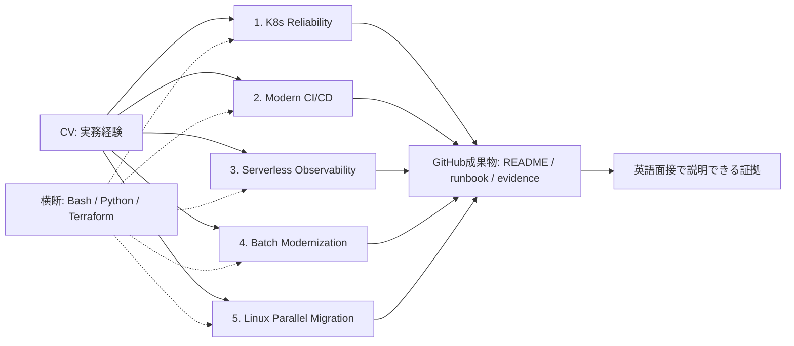

# DevOps/SRE Portfolio Roadmap

CV記載の実務経験を「小さく構築 → 検証 → Before/After → 考察」の形で再現し、カナダの DevOps/SRE 転職および日本の英語案件で **英語で説明できる状態** にするための学習計画です。

- 1テーマ = 2〜3時間のハンズオン × 1リポジトリ
- 本リポジトリ（`aws-kubernetes-reliability`）を **全ポートフォリオのテンプレート** として最初に完成させる
- CV由来の追加テーマは [additional-themes.md](./additional-themes.md) を参照

---

## 1. 結論：5テーマと優先順位

| 実施順 | リポジトリ | 主な狙い | CV実務との対応 | Status |
|---|---|---|---|---|
| 1 | `aws-kubernetes-reliability`（本リポジトリ） | EKS / Terraform / self-healing / HPA / 障害注入 | CVに無い Kubernetes/SRE 領域を補強 | 🚧 In progress |
| 2 | `aws-modern-cicd-comparison` | GitHub Actions + OIDC + CodeBuild + ECS native Blue/Green、Jenkins比較 | Jenkins約100ジョブ、CodeBuild/CodeDeploy 部分貢献 | ⬜ Planned |
| 3 | `aws-serverless-observability-lab` | API Gateway + Lambda + CloudWatch、障害注入と切り分け | API Gateway移行、CloudWatch運用、週3〜5件の障害対応 | ⬜ Planned |
| 4 | `aws-batch-modernization-lab` | EC2+cron vs EventBridge Scheduler + Step Functions + Fargate | EC2バッチ6本 → Step Functions/ECS 移行 | ⬜ Planned |
| 5 | `linux-parallel-migration-lab` | OS並行移行、互換性、cutover、rollback、runbook | CentOS 7 → Amazon Linux 2023 並行移行 | ⬜ Planned |

**GitHub プロフィールのピン留め順:** CI/CD → Kubernetes → Observability → Batch → Migration
（採用担当者が最初に見る「現代的な CI/CD とクラウドネイティブ」を上位に置く）

### 中心となる考え方

| 原則 | 内容 |
|---|---|
| 構築より検証 | 構成を大きくするのではなく、障害・変更・移行を意図的に起こし、判断・検証・rollback の証拠（スクリーンショット、ログ、runbook）を残す |
| Bash / Python は横断 | 単独テーマにせず、負荷試験・障害注入・smoke test・データ処理・cleanup として各リポジトリに組み込む |
| 英語案件対策 | 各 README に英語の Architecture / Trade-offs / Incident findings / Lessons learned を置き、技術英語の復習教材を兼ねる |



---

## 2. CVの棚卸し

### 既に強い実務経験（追加構築より「説明の準備」が重要）

- **Jenkins 大規模 CI/CD 運用**: 2環境・約100ジョブ。リリース、インフラデプロイ、Blue/Green、Shell 自動化
- **CodeBuild/CodeDeploy への部分貢献**: 8環境・月次リリースの ECS デプロイフローを、既存アーキテクチャ内で改善（全体設計オーナーではない）
- **IaC と Ansible**: CloudFormation をレイヤー別（network / EC2 / ECS / LB / WAF / CloudFront / DB / CodeBuild・CodeDeploy）に8環境管理。Ansible playbook 3ロール。新環境構築を数日 → 半日
- **Jenkins サーバ OS 並行移行**: CentOS 7 → Amazon Linux 2023、2環境、無停止。計画・runbook・ステークホルダー調整
- **EC2 バッチ近代化**: hourly / 6-hourly / daily の6本を Step Functions + ECS へ移行しアイドルコスト削減
- **CloudWatch 運用と障害対応**: CloudWatch / S3 ログ分析、週3〜5件、平均30分未満で復旧

### 面接で深掘りされやすい質問

| 質問 | 用意すべき説明の筋道 |
|---|---|
| “No service interruption” をどう確認した？ | 並行稼働期間、job/plugin/credential の移行手段、差分確認、cutover 条件、rollback 条件 |
| CodeBuild/CodeDeploy の “部分貢献” の境界は？ | 自分が変えた部分と既存部分、artifact、IAM、task definition、deployment group |
| 監視項目の選定理由は？ | CPU以外に latency / error rate / throttle / queue depth / capacity / business metric、warning/critical しきい値 |
| EC2 → サーバレス/オンデマンドの判断は？ | 料金以外に cold start、再実行、重複、timeout、ログ、運用責任、障害モード |

### 短時間で説明力が大きく伸びる領域

CV上 Terraform と GitHub ベース CI/CD は「提案・方針策定寄り」、GitHub Actions は「working knowledge」。誇張せず、以下で補強する。

- GitHub Actions → AWS の OIDC 認証
- Terraform で再現可能な最小環境
- Kubernetes の障害注入と HPA
- CloudWatch アラーム → runbook の一連の流れ
- Amazon ECS native blue/green（2025年7月発表）と CodeDeploy 方式の比較

---

## 3. 候補テーマ評価マトリクス（5点満点）

| 候補 | CV整合性 | DevOps/SRE訴求 | 2〜3時間 | 考察の深さ | 低コスト |
|---|---|---|---|---|---|
| Kubernetes reliability（既存） | 3 | 5 | 5（進行中） | 5 | 3 |
| CI/CD（GitHub Actions + CodeBuild + CodeDeploy）+ Jenkins比較 | 5 | 5 | 3 | 5 | 3 |
| Bash/Python 単独 | 4 | 3 | 5 | 3 | 5 |
| メトリクス/監視（CloudWatch中心） | 5 | 5 | 5 | 5 | 5 |
| API Gateway / CloudFront / サーバレス | 5 | 4 | 5 | 5 | 5 |
| EC2バッチ vs サーバレスバッチ | 5 | 4 | 4 | 5 | 4 |
| OS並行移行 | 5 | 4 | 4 | 5 | 4 |

**統合・除外の判断**

- **Bash/Python 単独は作らない** — 「何を自動化し、失敗時にどう扱ったか」の方が説明しやすい。CVにも Jenkins バッチ自動化、PowerShell/Microsoft Graph 監査レポート自動化が既にある
- **サーバレスと監視を1本に統合** — API Gateway + Lambda に 5xx / 遅延を注入すれば、メトリクス選定・Logs Insights・アラーム・triage・RCA を同じ枠で検証できる
- **CodeDeploy は主役にせず比較対象** — AWS は CodeDeploy 方式から ECS native blue/green への移行手順を公開済み。実装は native、CodeDeploy は比較ドキュメントとして残す

---

## 4. 各ポートフォリオのハンズオン設計

### ① aws-kubernetes-reliability（本リポジトリ）

**目的:** 「EKS を作った」から「障害と負荷に対して Kubernetes がどう回復・拡張するかを自分の言葉で説明できる」へ。

**最小構成**

- Terraform: VPC、Amazon EKS、managed node group
- Kubernetes: Deployment（3 replicas）、Service、readiness/liveness probe、requests/limits、Metrics Server、HPA（3〜10 replicas、CPU 50%）

**HPA の要点（説明できるようにする）**

- `desiredReplicas = ceil(currentReplicas × currentMetric / desiredMetric)`
- tolerance はデフォルト 10%（範囲内の変動は無視）
- 制御ループ間隔 `--horizontal-pod-autoscaler-sync-period` はデフォルト 15秒
- scale-down の stabilization window はデフォルト 5分
- CPU 利用率でスケールするには対象 Pod に **CPU request が必須**

**ハンズオン手順**

1. Terraform で再デプロイ、または現環境の状態確認
2. Nginx（または小さな Python Web アプリ）を 3 replicas で起動
3. `kubectl delete pod` → ReplicaSet による再作成を記録（self-healing）
4. readiness probe を失敗させ、Service の EndpointSlice から Pod が外れることを確認
5. Bash で負荷を注入し、`kubectl get hpa -w` と `kubectl get pods -w` の出力を保存
6. CPU request または HPA しきい値を変え、scale-out までの時間差を比較
7. `terraform destroy` でクリーンアップ

**Before / After**

| 項目 | Before | After |
|---|---|---|
| Replicas | 1 | 3（HA） |
| Probe | なし | readiness + liveness |
| Resource | なし | requests + limits |
| Autoscaling | なし | HPA 3〜10（CPU 50%） |
| 負荷テスト | なし | Bash 負荷注入とログ保存 |

**README に残す考察**

- self-healing（ReplicaSet）と autoscaling（HPA）は別の仕組み
- HPA が動かない時の確認順: Metrics Server → resource request → threshold → tolerance 10% → stabilization window 5分
- readiness と liveness を同じ条件にしない理由（依存先障害で全 Pod 再起動 = 障害の増幅）
- Node 容量不足で Pending → Node 側 autoscaler（Cluster Autoscaler / Karpenter）が別途必要

**Stretch:** kube-prometheus-stack で Prometheus + Grafana OSS を導入し、HPA の挙動をダッシュボード化

> **English summary:** I built a small EKS reliability lab to validate pod self-healing, readiness-based traffic control, and Horizontal Pod Autoscaling under generated load.

---

### ② aws-modern-cicd-comparison

**目的:** Jenkins 約100ジョブの運用経験を土台に、「GitHub Actions + AWS ネイティブ」型で責任分界をどう引き直すかを説明できるようにする（最重要）。

**推奨構成**

```text
Pull Request
  → GitHub Actions: lint / unit test / terraform validate

Merge to main
  → GitHub Actions (OIDC で一時 IAM 認証情報を取得)
  → CodeBuild: Docker build / test / push to Amazon ECR
  → Amazon ECS native Blue/Green deployment
  → CloudWatch alarm 監視
  → 失敗時は自動 rollback
```

**OIDC の要点**

- IAM Identity provider URL: `https://token.actions.githubusercontent.com`、Audience: `sts.amazonaws.com`
- trust policy で `token.actions.githubusercontent.com:sub` を条件にし、特定の org/repo/branch/environment のみ AssumeRole 可能にする
- job に `permissions: id-token: write` が必要（JWT 発行の許可であり、書き込み権限ではない）
- 2026年7月15日以降に作成された repository、または immutable subject claim に opt-in した repository では `sub` に不変の owner ID / repository ID が含まれるため、trust policy の形式を合わせる

**ECS native Blue/Green の要点**

- production listener rule に 2つの target group（重み 1 / 0）を用意
- `deploymentController=ECS`、`deploymentConfiguration.strategy=BLUE_GREEN`
- bake time、CloudWatch アラーム連動の失敗検知、`rollback: true`、deployment circuit breaker
- lifecycle hook（Lambda または pause）: `PRE_SCALE_UP` / `POST_SCALE_UP` / `TEST_TRAFFIC_SHIFT` / `POST_TEST_TRAFFIC_SHIFT` / `PRODUCTION_TRAFFIC_SHIFT` / `POST_PRODUCTION_TRAFFIC_SHIFT`。Lambda の戻り値で状態を返し、`IN_PROGRESS` で再実行させられる

**CodeDeploy 方式との比較（`docs/codedeploy-vs-ecs-native.md` に記載）**

| 観点 | CodeDeploy 方式 | ECS native |
|---|---|---|
| デプロイ単位 | application / deployment group / AppSpec | ECS service revision + deployment history |
| トラフィック制御 | listener rule の target group 入れ替え | listener rule の重み（1↔0）切替 |
| rollback | listener rule を元の target group に戻す | ECS が重みを切り戻す / アラーム連動 |
| lifecycle hook | AppSpec で指定、`PutLifecycleEventHookExecutionStatus` で結果返却 | service 設定内で定義、Lambda 戻り値、`IN_PROGRESS` 可 |
| シフトパターン | Canary / Linear / All-at-once | Blue/green（rolling / canary / linear へ戦略変更可） |

CodeDeploy の定義済み設定: `CodeDeployDefault.ECSAllAtOnce`、`ECSLinear10PercentEvery1Minutes`、`ECSLinear10PercentEvery3Minutes`、`ECSCanary10Percent5Minutes`、`ECSCanary10Percent15Minutes`

**ハンズオン手順**

1. Terraform で ECR、CodeBuild、ECS cluster、ALB + 2 target group、IAM/OIDC provider を作成
2. PR 時に lint / test / `terraform validate`
3. main merge 時に OIDC で role を assume
4. CodeBuild でイメージをビルドし ECR へ push
5. task definition 更新 → ECS native Blue/Green 実行
6. 起動失敗するイメージを意図的にデプロイし、circuit breaker / アラームで rollback を確認
7. 比較ドキュメントを作成

**Jenkins との比較軸**

| 観点 | Jenkins | GitHub Actions + AWS |
|---|---|---|
| Orchestration | Jenkinsfile / Job 設定 | Workflow YAML |
| Runner 運用 | Controller / agent の維持 | GitHub-hosted / self-hosted |
| AWS 認証 | Credentials plugin 等の長寿命キー | OIDC + IAM role（一時認証情報） |
| Build | Jenkins agent | CodeBuild |
| Artifact | Workspace / S3 / ECR | ECR / S3 |
| Deployment | Shell / plugin / CodeDeploy | ECS deployment API |
| Rollback | パイプライン実装依存 | circuit breaker / アラーム連動 |

> **English summary:** I translated my Jenkins experience into a modern GitHub-driven pipeline using OIDC, CodeBuild, ECR, and Amazon ECS native blue/green deployment. I also documented responsibility boundaries and rollback differences versus the CodeDeploy approach.

---

### ③ aws-serverless-observability-lab

**目的:** API Gateway 移行と CloudWatch 運用・障害対応を、1つの小さなインシデント・ラボとして再現し、golden signals・アラート設計・切り分け手順を言語化する。

**最小構成:** API Gateway HTTP API / Python Lambda / CloudWatch Logs・Dashboard・Alarms / Bash 負荷・障害注入 / Terraform

**エンドポイント設計**

| Path | 挙動 | 検証するもの |
|---|---|---|
| `/ok` | 常に 200 | ベースライン |
| `/error` | 常に 500 | 5xx アラート、Lambda Errors |
| `/slow` | sleep で遅延 | Latency アラート、Duration |
| `/business-failure` | 200 だが custom metric `business_failure` を送信 | HTTP 2xx でも失敗を検知するビジネスメトリクスの意義 |

**監視項目**

- API Gateway: Count、4xx、5xx、Latency
- Lambda: Errors、Duration、Throttles、ConcurrentExecutions
- Custom: `processed_success`、`business_failure`
- Logs Insights: request ID、error type、duration の相関

**ハンズオン手順**

1. Terraform（または SAM）で API Gateway / Lambda / Logs / Dashboard / Alarm を作成
2. 正常リクエストのベースラインを 5〜10分測定
3. Bash で正常 / 5xx / slow / business-failure を混在注入
4. Dashboard で可視化、アラート発火を確認
5. Logs Insights で requestId → error type → 原因箇所の triage 手順を記録
6. 修正後に再試験
7. custom metrics を無料枠 10 個以内に収める

**スコープ判断**

- CloudFront は stretch goal（キャッシュ戦略 TTL / stale data / origin protection は README で議論）
- Prometheus + Grafana OSS は ① の追加課題
- New Relic（恒久無料枠 100 GB/月）、Datadog、Zabbix は README で比較言及のみ

> **English summary:** I created a serverless incident lab and injected errors and latency to validate metrics, alarms, logs, and the triage workflow from detection to root cause, using CloudWatch within the free-tier limits.

---

### ④ aws-batch-modernization-lab

**目的:** EC2 バッチ6本の Step Functions + ECS 移行を、同じ Python 処理を異なる実行モデルで動かして定量比較する。

**最小構成**

- Python: S3 の CSV を集計して S3 に書き戻す
- Docker / Amazon ECR
- Before: ローカル Docker、または短時間だけ起動する EC2 + cron
- After: EventBridge Scheduler → Step Functions → ECS Fargate（`arn:aws:states:::ecs:runTask.sync`）→ CloudWatch Logs

**要点**

- `.sync` はタスク終了まで待機。`runTask` が HTTP 200 でも `Failures` があれば `AmazonECS.Unknown` で失敗扱い
- `ContainerOverrides` で command / environment を状態入力から渡す
- `waitForTaskToken` で人手承認や外部 callback を挟める
- EventBridge Scheduler: cron / rate / one-time、タイムゾーン、flexible time window、retry policy、DLQ。無料枠 月1,400万 invocation

**ハンズオン手順**

1. Python batch をローカル実行 → コンテナ化して ECR へ push
2. Step Functions から Fargate task を `.sync` で実行
3. EventBridge Scheduler で起動
4. 意図的に失敗させ、Scheduler の retry と Step Functions の `Retry` / `Catch` を記録
5. 同じ input を再実行し、idempotency キーで重複出力を防ぐ
6. CloudWatch Logs と execution history を保存

**比較軸（`docs/trade-offs.md`）**

| 観点 | EC2 + cron | Step Functions + Fargate |
|---|---|---|
| アイドル計算コスト | 常時発生 | 0 |
| OS パッチ | 自分で実施 | 不要 |
| 起動遅延 | なし（起動済み） | タスク起動時間 |
| 並行実行 | cron ロック | Map / Parallel |
| retry | スクリプト実装 | Scheduler + Step Functions の2層 |
| timeout | kill スクリプト | 宣言的に設定 |
| idempotency | 自前 | 自前（アプリ側） |
| ログ | EC2 上 or 手動転送 | CloudWatch Logs に集約 |
| IAM | インスタンスロール | タスクロール + 実行ロール |
| 運用責任 | OS 層まで | コンテナ内のみ |

> **English summary:** I compared an always-on cron-style batch model with an on-demand container workflow using EventBridge Scheduler, Step Functions, and Fargate, including retries, timeouts, and idempotent reprocessing.

---

### ⑤ linux-parallel-migration-lab

**目的:** 「Jenkins サーバ並行移行を無停止で完了」を、構築技術ではなく **アセスメント・並行稼働・検証・cutover・rollback** の観点で説明できるようにする。

**再現範囲（proxy lab）:** Source = Amazon Linux 2、Target = Amazon Linux 2023、Workload = Python systemd service + 定期 Bash ジョブ。README に「CentOS 7 → AL2023 の実務移行を簡略化した proxy lab」と明記する。

**AL2023 で押さえる差分（AWS 公式）**

- `amazon-linux-extras` は存在しない → namespaced package
- cron はデフォルト未インストール → systemd timer へ移行
- Python 2.7 スクリプトの Python 3 化
- 公式ドキュメント “Comparing AL2 and AL2023” と “Package changes in AL2023” を確認

**ハンズオン手順**

1. Terraform で Source / Target の2台を作成
2. `collect_inventory.sh` で package / service / port / file owner / systemd timer / 環境変数を取得
3. Ansible で Target を構築
4. config / data を同期し checksum で差分検証
5. 両サーバに同じ smoke test
6. endpoint 変数 / hosts を Target へ切替（cutover）
7. Target を意図的に停止し Source へ rollback
8. test evidence と migration runbook を保存

**移行検討マトリクス（必須）:** package/runtime 互換性、service user/permission、Python/library 依存、scheduled jobs（cron → systemd timer）、data consistency、DNS/endpoint、TLS/certificate、monitoring、backup、cutover criteria、rollback trigger、decommission criteria

> **English summary:** I reproduced a parallel-run Linux migration and documented compatibility checks, validation gates, cutover criteria, and rollback procedures rather than treating migration as a simple server rebuild.

---

## 5. 監視ツールの判断

| ツール | 扱い | 理由 |
|---|---|---|
| CloudWatch | **コア** | CVの強み。無料枠（10 custom metrics / 10 alarms / 5 GB logs / 3 dashboards）で成立 |
| Prometheus + Grafana OSS | ① のサブ課題 | EKS 内メトリクスの可視化に自然。OSS で無料 |
| New Relic | 比較言及のみ | 恒久無料枠あり。将来の SaaS APM 評価の比較軸 |
| Datadog / Zabbix | 使用しない | 有償ライセンスまたは別サーバ構築が必要で、短時間・無料の目的に合わない |

説明できるようにすべき論点:

- どの症状を何の metric で検知するか（latency / error rate / throttle / queue / capacity / business metric）
- infrastructure metric と application/business metric の違い
- しきい値と false positive（HPA tolerance と同じ発想）
- アラート → runbook の導線
- metrics / logs / traces の使い分け
- retention と ingestion cost のトレードオフ

---

## 6. 全リポジトリ共通テンプレート

```text
README.md
terraform/
app/
scripts/            # Bash: 負荷注入、smoke test、cleanup / Python: データ処理、障害注入
tests/
docs/
  architecture.png
  test-results.md
  decision-log.md
  failure-scenarios.md
  cost-and-cleanup.md
  runbook.md
  interview-notes-en.md
Makefile
cleanup.sh
```

**README 固定セクション**

1. Problem / Background
2. Architecture（図 + 簡潔な説明）
3. What I built
4. Test scenarios
5. Before / After
6. Failure injected
7. Observed evidence（スクリーンショット、ログ抜粋）
8. Trade-offs
9. Connection to my production experience
10. What I would change for production
11. Cleanup（`terraform destroy` 手順とコスト見積）
12. English interview summary

### コスト上限の遵守

- 各ラボは無料枠内で完結するよう設計し、終了時に必ず `terraform destroy`
- **EKS はコントロールプレーンが時間課金（無料枠なし）** — 検証時間をまとめ、終了後すぐ destroy
- ECS/Fargate はタスク実行時間のみ課金
- AWS Budgets でアラート（例: 月 $10）を設定してから着手する
- 料金・無料枠は変更されるため、着手時に公式料金ページで再確認する

---

## 7. 本リポジトリの完了チェックリスト

テンプレートとして確立するための Definition of Done:

- [ ] Terraform で EKS を再作成・破棄できる
- [ ] Self-healing のエビデンス（`kubectl delete pod` 前後のログ）
- [ ] Readiness 失敗時に Endpoint から外れるエビデンス
- [ ] HPA scale-out / scale-in のエビデンス（`kubectl get hpa -w`）
- [ ] Rolling update と `kubectl rollout undo` のエビデンス
- [ ] `docs/runbook.md`（HPA が動かない時 / Pod が Pending の時）
- [ ] `docs/failure-scenarios.md`、`docs/cost-and-cleanup.md`
- [ ] README に英語セクション（Architecture / Trade-offs / Incident findings / Lessons learned）
- [ ] `docs/interview-notes-en.md`

完了後、同じ構成で ② → ③ → ④ → ⑤ を作成し、その後 [additional-themes.md](./additional-themes.md) の追加テーマへ進む。

> **成果物の価値は構成の大きさではなく、「なぜ選び、どう壊し、何を観測し、どう戻したか」を CV 上の実務経験と結び付けて英語で説明できることにある。**
